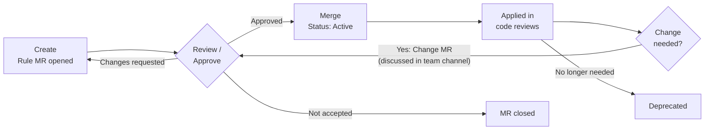

# Code Review Standard

## Contribution Guide

This guide defines how to submit a code review rule and get it merged. Questions, problems with existing rules, and anything not covered here are discussed in the team channel.

## 1. Roles

| Role            | Responsibility                                                                                       |
| --------------- | ---------------------------------------------------------------------------------------------------- |
| **Maintainer**  | One per scope (GE, FE, BE). Owns the rules in that scope; reviews and approves rule MRs, confirms IDs. |
| **Contributor** | Any team member who creates rules or gives feedback.                                                 |

Role holders are maintained in the team space. One person may hold multiple roles, but cannot approve their own MR.

## 2. Rule lifecycle

| Status         | Meaning                                                                    |
| -------------- | -------------------------------------------------------------------------- |
| **Active**     | Enforced according to severity (see README).                               |
| **Deprecated** | No longer enforced; retained for history. Add `Replaced by` if applicable. |

**Rule IDs are never reused**, including deprecated IDs and IDs from closed MRs.

## 3. Submit a rule

### 1. Create

- Take the next free ID in the scope (e.g. `BE-002`). If two open MRs use the same ID, the first to merge keeps it; the other renumbers.
- Create `rules/<SCOPE>/<ID>.md` from `rules/_TEMPLATE.md`, with `Status: Active`.
- Open an MR titled `Rule <ID>: <short title>`. In the MR description, state the problem the rule solves, the scope, and the proposed severity.
- Complete the [MR checklist](#6-mr-checklist).

### 2. Review / Approve

- Get **2 approvals, including the Maintainer** of the scope.
- The Maintainer confirms the ID. Reviewers may request changes, or the Maintainer may close the MR with a reason.

### 3. Merge

- The rule is enforced from the merge date.
- After merge, announce the rule in the team channel.

## 4. Change or deprecate a rule

- Raise it in the team channel first, then open an MR with the agreed change. It follows the same Review / Approve and Merge steps.
- To deprecate, set `Status: Deprecated` and add `Replaced by: <ID>` if a successor exists.

## 5. Approvals

- Every rule MR (new rule, change, deprecation) requires **2 approvals, including the Maintainer** of the scope. The author's approval does not count.
- Changes to this process, closed lists, `build/`, or CI require approval from a Maintainer of each scope.

## 6. MR checklist

- [ ] ID is the next free ID in the scope and matches the file name (new rules).
- [ ] MR description states the problem, scope, and severity.
- [ ] File path and structure follow `rules/<SCOPE>/<ID>.md` and `rules/_TEMPLATE.md`.
- [ ] `Title` is one imperative sentence.
- [ ] `Description` explains what and why (1–3 sentences).
- [ ] `Bad` and `Good` are real, compilable code examples.
- [ ] `Exceptions` is completed (`None` if not applicable).
- [ ] Severity and status are correct.
- [ ] Required approvals are present.
- [ ] CI pipeline passes.
